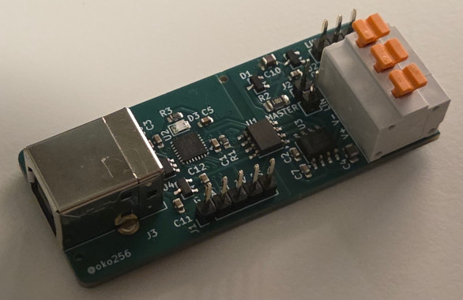

# USB LIN Card hardware

KiCad project for the USB LIN Card: a small, open hardware USB to LIN bus adapter. The card connects
a PC to a single LIN bus over USB. The LIN side is galvanically isolated from the USB side and is
powered from the LIN bus supply.

The card is meant to be used with the [USB LIN Card firmware](https://github.com/oko256/usb-lin-card-fw).
See the firmware repository for what the card can do on the bus (commander, responder and
monitoring modes), the host protocol, supported baud rates and flashing instructions. This README
only covers the hardware.

## Features

- **USB 2.0 Full Speed** device on a USB-B connector, with ESD protection on the data lines.
- **One LIN channel** using a LIN 2.2A / ISO 17987-4 / SAE J2602 compliant transceiver.
- **Galvanic isolation** between the USB and LIN sides with a digital isolator.
- **Jumper-selectable commander (master) termination**: 1 kΩ pull-up with series diode.
- **Screwless terminal block** for the bus, plus a 2.54 mm pin header with the same signals.
- **Reverse polarity protection** on the bus supply input.
- **Status LED** and an **SWD header** for debugging.
- **No crystal:** the MCU runs its USB from its internal 48 MHz oscillator, which is trimmed from
  the USB SOF packets.
- Small 2-layer board, 60 × 25 mm. All components on one side.

## Specifications

| Item | Value |
|---|---|
| Host interface | USB 2.0 Full Speed, USB-B receptacle |
| MCU | STM32F042G6U6 (ARM Cortex-M0, 48 MHz, 32 KB flash, 6 KB RAM, UFQFPN28) |
| LIN transceiver | TI TLIN10285DRQ1 (LIN 2.2A, ±58 V bus fault protection, integrated 5 V LDO) |
| Isolator | TI ISO6721BD, 1 + 1 channel, basic isolation (3000 VRMS rated). Isolation rating has not been verified with assembled card. |
| Commander termination | 1 kΩ and diode to V+, enabled with the MASTER jumper |
| Bus connectors | Würth WR-TBL 691411510003, 3-pole 5.08 mm screwless terminal block, and 3-pin 2.54 mm header |
| Debug | 5-pin 2.54 mm SWD header |
| PCB | 60 × 25 mm, 2 layers |

## Connectors and jumpers

### LIN bus (J5 terminal block, J4 header)

The terminal block and the pin header are wired in parallel, so either one can be used.

| Pin | Silkscreen | Signal |
|---|---|---|
| 1 | V+ | Bus supply (e.g. battery plus). Powers the LIN side of the card. |
| 2 | V- | Bus ground (e.g. battery minus). Isolated from USB ground. |
| 3 | LIN | LIN bus line |

**The card needs supply on V+ to work.** The LIN side is not powered from USB. Without V+ the
transceiver and the bus side of the isolator are unpowered, and the card can't send or receive
anything, even though it still shows up on USB.

V+/V- is protected against reverse polarity.

### MASTER jumper (J2)

Fit the jumper when the card is the commander (master) node of the bus. It connects a 1 kΩ pull-up
resistor in series with a diode from V+ to the LIN line, as the LIN specification requires for the
commander node.

Leave it open when the card is a responder or monitors a bus that already has a commander. Then only
the transceiver's internal responder pull-up is on the bus.

### SWD (J1)

| Pin | Silkscreen | Signal |
|---|---|---|
| 1 | G | GND (USB side) |
| 2 | DA | SWDIO |
| 3 | CL | SWCLK |
| 4 | 3V | 3.3 V |
| 5 | RS | NRST |

The SWD header is only needed for debugging. The firmware itself can be flashed over USB with the
STM32 built-in USB DFU bootloader, so you don't necessarily need to even populate the SWD header.
See the firmware repository for instructions.

### USB (J3)

Standard USB-B receptacle. The connector shield is tied to USB ground.

## License

Copyright (c) 2026 Olli Kokko <https://github.com/oko256/usb-lin-card-hw>

SPDX-License-Identifier: CERN-OHL-P-2.0

This KiCad project is licensed under the CERN-OHL-P-2.0 license. See LICENSE file for details.

Some symbols, footprints, and 3D models in this project are from Würth Elektronik. See https://github.com/WurthElektronik/KiCad-Library for more info.
